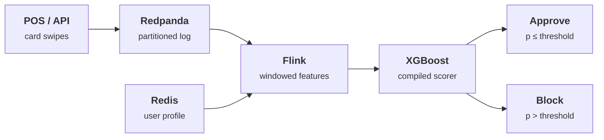

# Real-time fraud detection

> Thousands of card transactions per second, each scored and blocked or approved within a 20 ms latency budget (target, not yet measured on the real pipeline).

**Interactive demo:** [natanmartins.com.br/projects/fraud-stream](https://natanmartins.com.br/projects/fraud-stream/) · [versão em português](https://natanmartins.com.br/pt/projects/fraud-stream/)

**Status:** in construction. This README separates what exists from what is planned, and is updated as parts ship.

## The problem

A fraud decision is only useful before the payment clears. That turns a modelling problem into a latency budget: features must be computed over sliding windows, user profiles fetched from memory, and the model evaluated, all inside a single authorization round-trip.

## Architecture



1. Transactions land on a partitioned Redpanda topic, keyed by card so each card’s events stay ordered.
2. Flink keeps per-card state: transaction velocity over 60 s, amount z-score against the card’s history, distance from the last location.
3. Redis holds the long-lived profile (typical merchants, home region) so the stream job never touches a database.
4. A gradient-boosted model, compiled to native code, turns features into a fraud probability. A threshold, tuned on the cost of false blocks versus missed fraud, makes the call.

**Stack:** Redpanda · Apache Flink · Redis · XGBoost → Treelite · Prometheus

## What exists today

### Real
- The scoring function and threshold logic in the demo run live in your browser.
- Precision, recall and latency percentiles are computed live from every simulated transaction, not just the drawn ones.

### Simulated in the browser demo
- Transactions are synthetic, generated from two distributions (legit, fraud).
- Stage latencies come from a queueing model, not from a measured cluster.
- The demo model is a hand-weighted logistic score, standing in for XGBoost.

### Not built yet (roadmap)
- [ ] Redpanda + Flink + Redis pipeline (docker-compose)
- [ ] XGBoost trained on a public fraud dataset
- [ ] Load test with measured p99

## Repository layout

```
demo/   the simulation that powers the interactive page, with tests that check its claims
```

The production pipeline will live alongside it (`pipeline/`, `docker-compose.yml`) as the roadmap items land.

## Run the demo tests

Requires Node.js 22+.

```bash
cd demo
npm test
```

## License

MIT © 2026 Natan Oliveira Martins
